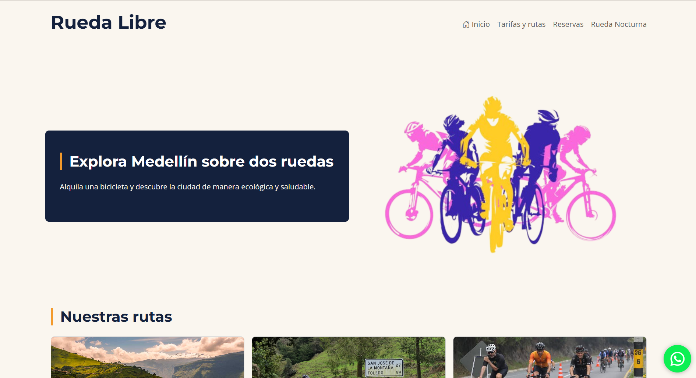
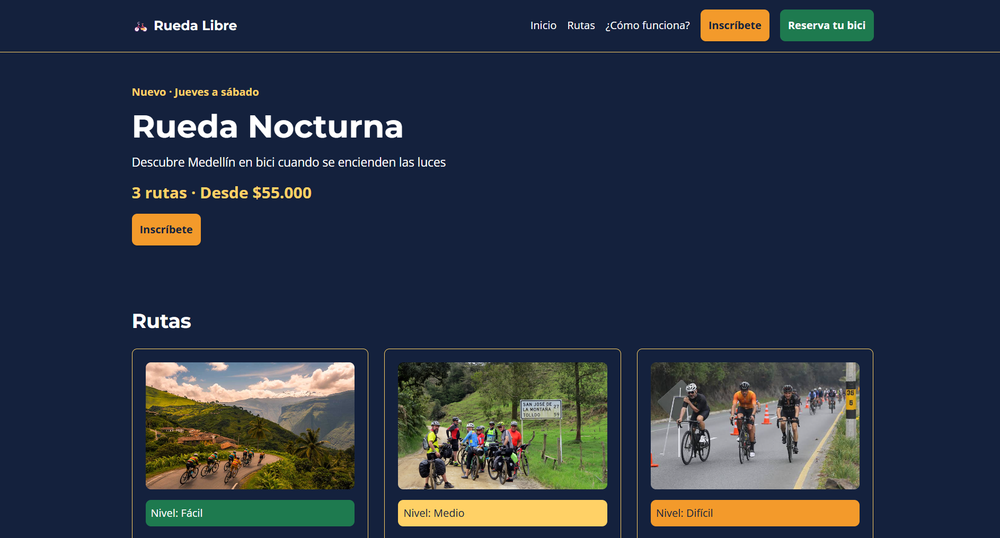
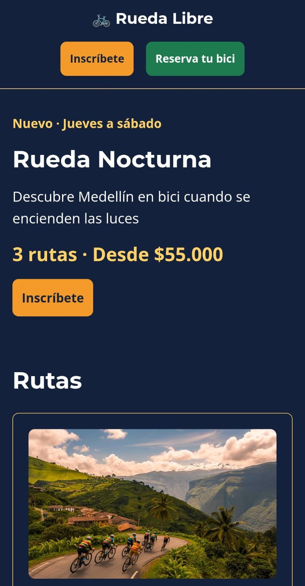

# 🚲 Rueda Libre :D

## Descripción

Rueda Libre es una página web de alquiler de bicicletas en Medellín. También cuenta con Rueda Nocturna, una campaña que ofrece recorridos nocturnos por la ciudad.

## Páginas del proyecto

- **Inicio:** información general de Rueda Libre.
- **Tarifas y rutas:** bicicletas, precios y recorridos.
- **Reservas:** formulario para reservar bicicletas.
- **Rueda Nocturna:** rutas nocturnas, planes y formulario de inscripción.

## Tecnologías utilizadas

- HTML
- CSS
- Bootstrap 5
- Tailwind CSS
- Git y GitHub

## Enlaces

- [Sitio Rueda Libre] https://alexxabr-19.github.io/rueda-libre/
- [Rueda Nocturna] https://alexxabr-19.github.io/rueda-libre/nocturna/index.html
- [Repositorio de GitHub] https://github.com/alexxabr-19/rueda-libre

## Bootstrap vs. Tailwind

Bootstrap me pareció más fácil al principio porque tiene componentes listos para utilizar.

Tailwind me gustó más para personalizar los colores, las fuentes y el modo oscuro. Por eso recomiendo Tailwind para continuar desarrollando Rueda Nocturna. Aunque sí hay que practicarlo bastante.

## Capturas de pantalla

### Vista en computador

### Vista en celular

### Modo oscuro

## Aprendizajes

Durante el proyecto aprendí a utilizar HTML, CSS, Flexbox, Grid, Bootstrap y Tailwind. También aprendí a crear formularios, hacer páginas responsive y trabajar con GitHub. También aprendí a no atrasarme tanto con las cosas, tengo que administrar mejor mi tiempo para poder hacer las cosas mejor. Gracias por todo <3.

## Autor

Alexa Bedoya Rojas